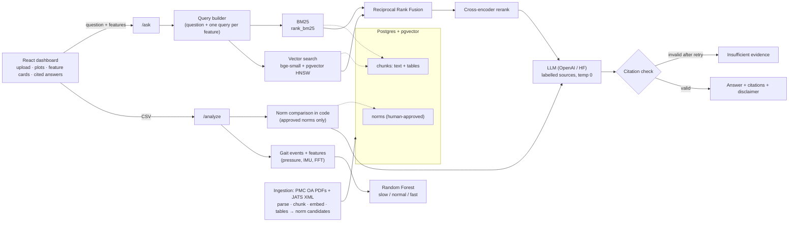
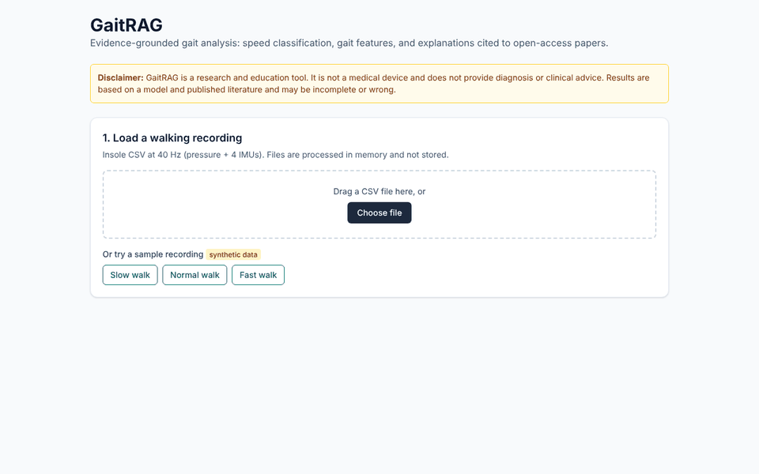

# GaitRAG

Evidence-grounded gait analysis assistant. Upload a walking recording (insole IMU + pressure CSV), get a walking-speed classification, interpretable gait features, and an explanation compared against published norms, with every claim cited to a paper, page and table, or an explicit "insufficient evidence".

> **Disclaimer:** GaitRAG is a research and education tool. It is not a medical device and does not provide diagnosis or clinical advice. Results are based on a model and published literature and may be incomplete or wrong.

**Status:** all milestones are implemented (see [`CLAUDE.md`](CLAUDE.md)), and retrieval and latency results are in. Still pending: generation metrics and live explanations (they need an LLM API key) and the live deployment (the automation is ready; see [docs/DEPLOYMENT.md](docs/DEPLOYMENT.md)).

## Architecture



## Run it

**Production-like (one container: API + UI):**

```bash
echo "POSTGRES_PASSWORD=change-me" > .env           # plus OPENAI_API_KEY=... for explanations
docker compose -f docker-compose.prod.yml up -d --build
docker compose -f docker-compose.prod.yml run --rm app ingest   # once: download + index the papers
```

Open http://localhost:8000 and click **Normal walk**. API docs are at `/docs`.

**Development (hot reload):**

```bash
cp .env.example .env
docker compose up --build       # API :8000, UI :5173, Postgres :5432
```

| Endpoint | Purpose |
|---|---|
| `POST /analyze` | CSV → speed prediction, gait features, comparison with approved norms |
| `POST /ask` | question (+ features) → cited answer or insufficient evidence |
| `POST /search` | retrieval only, with ablation switches |
| `GET /papers` | the corpus, with attribution and licence |
| `GET /samples` | synthetic demo recordings |
| `GET /health` | liveness and database status |

**Deploy:** Hugging Face Spaces (app) + Neon (Postgres with pgvector), deployed by GitHub Actions after CI passes on `main`. See [docs/DEPLOYMENT.md](docs/DEPLOYMENT.md). `/ask` is rate-limited, because it spends the owner's API credit.

## Results



**Retrieval** ([full report](eval/results/retrieval_ablation_ms-marco-MiniLM-L6-v2.md); 50 questions: 40 answerable, 10 unanswerable; top-10 chunks; CPU):

| Ablation | Recall@5 | Recall@10 | MRR | Median latency |
|---|---|---|---|---|
| 1. Vector only (bge-small + pgvector) | 0.804 | 0.825 | 0.749 | 24 ms |
| 2. BM25 only | 0.821 | 0.883 | 0.749 | 2 ms |
| 3. Hybrid (RRF) | 0.829 | 0.900 | 0.749 | 25 ms |
| 4. Hybrid + reranker (MiniLM) | 0.817 | 0.854 | 0.776 | 861 ms |
| 5. Hybrid + reranker + table chunks | **0.904** | **0.917** | **0.857** | 871 ms |

- **Table chunks matter most.** Normative values live in tables, and indexing them raised Recall@5 from 0.82 to 0.90.
- **Reranker choice.** With `bge-reranker-base` ([report](eval/results/retrieval_ablation_bge-reranker-base.md)), config 4 improves (Recall@5 0.863), but config 5 is no better (0.896, MRR 0.838) and each query takes 6.7 s instead of 0.87 s. MiniLM therefore stays the default.
- **The MiniLM reranker alone** raised MRR but slightly lowered Recall@5 (0.829 → 0.817).
- **Insufficient-evidence gate:** a threshold of `MIN_RERANK_SCORE = 1.76` (config 5) would catch all 10 unanswerable questions, with abstention precision 0.83. It was fitted on this same small set, so it is not enabled by default.

**Latency** ([report](eval/results/latency.md), 4-core CPU, warm): `/analyze` p50 104 ms / p95 123 ms; `/search` p50 954 ms / p95 1225 ms.

**Speed classifier:** evaluated on **synthetic** data only ([report](backend/models/training_report.md)). This shows that the pipeline runs and says nothing about real-world accuracy.

**Caveats.**
- The question set was drafted by the AI assistant from the papers' text and approved by the owner, not written independently, so retrieval results may be optimistic.
- Norm values were proposed by the AI assistant and approved by the owner.
- **Pending:** generation metrics (abstention, citation accuracy, RAGAS, OpenAI vs HuggingFace) need an LLM API key, so they have not been run.

## Local development

Backend (Python 3.11):

```bash
cd backend
python -m venv .venv && source .venv/bin/activate
pip install -e ".[dev]"
uvicorn app.main:app --reload
pytest
```

Frontend (Node 22):

```bash
cd frontend
npm install
npm run dev
npm test
```

Pre-commit hooks (ruff, black, prettier):

```bash
pip install pre-commit
pre-commit install
```

## Speed classifier (M1)

Pipeline for one recording (40 Hz CSV):

1. **Validate** columns, types, single trial, at least 10 s, and the sampling rate.
2. **Detect gait events** from insole pressure: total foot load against a relative threshold, with threshold crossings interpolated between samples for timing finer than 25 ms.
3. **Interpretable features:** cadence, stride time and its CV, stance/swing %, and left-right symmetry index of stance time and peak pressure.
4. **Model features:** the gait features, plus per-channel statistics of z-scored signals, plus Welch band powers of each IMU's acceleration magnitude.
5. **Random Forest** (300 trees) predicts slow, normal or fast.

Rebuild the model:

```bash
python scripts/make_synthetic_gait.py --out data/synthetic
python scripts/train_model.py --data data/synthetic
```

Evaluation uses `GroupKFold` by subject, so no person appears in both training and test folds. Results are in [`backend/models/training_report.md`](backend/models/training_report.md).

> **These results are on SYNTHETIC data** and only show that the pipeline runs. They say nothing about real-world accuracy.

## Paper corpus (M2)

```bash
python scripts/download_papers.py   # PDFs + JATS XML -> data/papers/pdfs/ (git-ignored), MD5-checked
python scripts/ingest_papers.py     # parse, chunk, embed -> Postgres; refresh norms_review.csv
```

- **Sources.** Open-access papers listed in [`data/papers/manifest.csv`](data/papers/manifest.csv) with DOI, authors, licence and source URL. Only CC-BY, CC-BY-SA and CC0 are accepted. PDFs come from the [PMC Open Access dataset](https://pmc.ncbi.nlm.nih.gov/tools/pmcaws/) and are checked against its published MD5.
- **Parsing.** PyMuPDF page by page, so every passage keeps its page number. The parser removes running headers and footers, normalizes ligatures, re-joins hyphenated words and labels standard sections. References, back matter and text inside tables are dropped.
- **Chunking.** About 300 tokens per chunk (bge tokenizer), split at sentence boundaries, with up to 50 tokens of whole-sentence overlap. Chunks never cross a page or section break, so a citation's page is exact.
- **Embeddings.** `BAAI/bge-small-en-v1.5`, 384 dimensions, normalized. Each chunk is embedded with a "title > section" header. Queries use bge's instruction prefix. They are stored in pgvector with an HNSW cosine index, plus a generated `tsvector` column for keyword search (M3).
- **Tables.** Tables are taken from PMC's JATS XML, which gives exact cells and merged-cell spans and was more accurate than reading PDF layout. Each XML table is placed on the PDF page that contains its caption *and* its own numbers, so table citations keep exact pages. PDF table detection (PyMuPDF) is the fallback for tables the XML lacks.
- **Tables to norms.** Rules propose candidate values (cadence, stride time and its CV, stance/swing %, symmetry, gait speed) into [`data/papers/norms_review.csv`](data/papers/norms_review.csv). **A person approves each value.** Only approved rows whose text still appears verbatim in the source table are loaded into the `norms` table.

Set `decision` to `approve` or `reject` in the review CSV (you may correct metric, population, units or the parsed numbers), then re-run `ingest_papers.py`. Unchanged PDFs are skipped. Your edits are kept for every row that has a decision or a note; untouched rows are refreshed from extraction.

**AI-suggested decisions** for the clearly normative tables (P001 T3, P003 T4, P004 T2, P006 T2, P009 T2, P020 T1) are in [`data/papers/norms_review_suggestions.csv`](data/papers/norms_review_suggestions.csv), each with the reason checked against the paper. They are suggestions only: nothing is approved until the owner sets `decision` in `norms_review.csv`.

The `flags` column gives automatic hints: no or unusual units, a value outside rough plausibility bounds, SD larger than the mean, a missing population, or a reliability, regression or validation table. **The bounds are sanity limits chosen for this project, not published norms.** A flag is not a decision; it only shows where to look first.

## Retrieval (M3)

```
query ─► vector (pgvector, cosine, top 50) ─┐
     └─► BM25 (rank_bm25, top 50)        ───┴─► RRF (k = 60) ─► cross-encoder rerank (top 30) ─► top 8
```

- **What is searched.** 921 prose chunks, plus 595 **table chunks**: each table's caption and its rows written out as "row — header: value", cited as `[P001, p.11, Table 3]`. Normative values live in tables, so without these chunks the reference-value tables could not be retrieved. Wide rows are split so no chunk exceeds the embedding model's 512-token input.
- **Hybrid search.** Embeddings capture paraphrases, while BM25 catches exact terms such as "CoV" or "PODOSmart". The two rankings are merged with Reciprocal Rank Fusion, which uses ranks only, so there are no score scales to normalize.
- **pgvector details.** HNSW search examines only `hnsw.ef_search` candidates (default 40), so `LIMIT 50` silently returned 40 rows. The retriever raises it per query. When table chunks are switched off, the `kind = 'text'` filter is applied after the HNSW search, which returned 41 of 50 rows, so iterative scan is enabled. Both cases are covered by tests.
- **Reranker.** The default is `cross-encoder/ms-marco-MiniLM-L6-v2`. `BAAI/bge-reranker-base` (in the original stack) was about 7x slower on CPU (30 pairs in ~5.3 s vs ~0.7 s on the 4-core dev sandbox) and stays selectable via `RERANKER_MODEL`. Both are compared in the M6 ablation.
- **Feature queries.** One short, norm-focused query per gait feature, without the user's numbers. The predicted speed class is *not* in the query text: an early version added "at preferred (self-selected) walking speed", which matched one paper's title and pulled every query to it.
- **Ablations.** Set `RETRIEVAL_MODE=vector|bm25|hybrid`, `RERANK=true|false` and `RETRIEVE_TABLES=true|false`, or override per request:

```bash
curl -X POST localhost:8000/search -H 'Content-Type: application/json' \
  -d '{"query": "stride time variability at slow speed", "mode": "hybrid", "rerank": true, "tables": true}'
```

Latency, measured on the 4-core development sandbox (CPU only, median per query): vector 22 ms, BM25 2 ms, hybrid 23 ms, hybrid + MiniLM rerank about 0.8 s (about 4 s for a recording's 5 feature queries). These are development measurements; the end-to-end p50/p95 numbers come from `eval/run_latency_eval.py` in M6.

## Generation (M4)

```bash
curl -X POST localhost:8000/ask -H 'Content-Type: application/json' -d '{
  "question": "Is my cadence typical for my walking speed?",
  "features": {"cadence_steps_per_min": 112.0, "stride_time_cv_pct": 2.1},
  "prediction": "normal"}'
```

1. **Retrieve.** Passages for the question and for each feature are merged round-robin, deduplicated and capped at `MAX_CONTEXT_CHUNKS` (8).
2. **Compare with norms, in code.** Each feature is compared with every *approved* norm row: unit conversion, z-score, and within mean ± 1 SD (or the published range). The LLM only explains these numbers and never computes them. The same comparisons fill `norms_comparison` in `/analyze`.
3. **Generate.** Temperature 0, with one prompt for every provider. Each source has a ready-made label such as `[P006, p.5, Table 2]` that the model must copy after every factual sentence. Source text is treated as data, and diagnosis or medical advice is forbidden.
4. **Check citations.** Every label in the answer must be one that was provided, and there must be at least one. If not, the model gets one retry with specific feedback; after that the answer is reported as **insufficient evidence**. Unverified citations never reach the user.
5. **Insufficient-evidence mode.** This applies with no sources, when the model replies `INSUFFICIENT_EVIDENCE`, or after a failed citation check. A threshold on the best reranker score (`MIN_RERANK_SCORE`) is off until it is calibrated on unanswerable questions in M6.

**Providers.** OpenAI and HuggingFace Inference Providers both speak the chat-completions API, so one `httpx` client serves both. Choose one with `LLM_PROVIDER=openai|huggingface` and `LLM_MODEL`, with the key in `OPENAI_API_KEY` or `HF_API_TOKEN`. Without a key, `/ask` returns `503`; `/analyze` and `/search` still work.

## Dashboard (M5)

Open http://localhost:5173 and click **Slow / Normal / Fast walk**. These are synthetic sample recordings served by `GET /samples`. You can also drop your own 40 Hz CSV.

1. **Walking speed:** the prediction with class probabilities and a visible "model trained on synthetic data" badge.
2. **Sensor signals:** left and right foot load and IMU acceleration (Recharts, drawn at up to 1,000 points).
3. **Feature cards:** each gait feature with a "vs published norm" verdict (✓ within, ▲ above, ▼ below 1 SD, so it is not shown by colour alone), the z-score, the population and a citation chip. Without approved norms the card says so instead of inventing one.
4. **What the literature says:** an automatic cited explanation from `/ask`, with clickable citation chips that open the source (title, authors, page, table, licence, supporting passage and a link to the open-access paper), plus a follow-up question box.

Without an LLM key the explanation section says so, and the analysis still works.

## Evaluation (M6)

The evaluation scripts are in [`eval/`](eval/README.md). The question set, `eval/questions.jsonl`, is written by the project owner (50–100 questions of types `norm_lookup`, `method_comparison`, `feature_interpretation` and `unanswerable`).

```bash
python eval/run_retrieval_eval.py        # Recall@5/10, MRR for the 5 ablation configs
python eval/run_generation_eval.py       # abstention P/R, citations, latency (needs an LLM key)
python eval/run_latency_eval.py          # p50/p95 of /analyze, /search, /ask (running API)
```

**Results:** see [Results](#results). Retrieval and latency come from real runs on `eval/questions.jsonl` (see [its provenance](eval/README.md)); generation metrics are pending an LLM key. The placeholder file (`eval/questions.example.jsonl`) exists only to test the scripts, and runs on it are labelled `PLACEHOLDER` and git-ignored.

- **Retrieval ablations:** (1) vector, (2) BM25, (3) hybrid RRF, (4) + reranker, (5) + table chunks. Running with `--reranker BAAI/bge-reranker-base` compares the two rerankers.
- **Generation:** the same pipeline as `/ask`. Use `--no-norms` for the norms-lookup ablation, and set `LLM_PROVIDER` to compare OpenAI with HuggingFace.
- **Citation accuracy:** each run writes a citation-check sheet. Mark `supported` with yes or no, then score it with `--score-citations`.
- **Gate calibration:** the retrieval run suggests `MIN_RERANK_SCORE` from the reranker scores of answerable vs unanswerable questions.
- **Not yet included:** RAGAS metrics, which need an LLM judge.

## Limitations

- **Not a diagnostic tool.** Comparisons describe how a value relates to published groups; they say nothing about health.
- **Synthetic data only.** The speed classifier was trained and evaluated on synthetic recordings whose parameters were invented, not taken from published norms. The CSV schema and IMU placement still need confirming against the real dataset, and the gait-event thresholds were tuned on synthetic signals.
- **Normalization at inference.** Research-style subject-wise z-scoring needs several trials per person. A single upload is normalized against itself (the deployed model is trained the same way), which cost accuracy on synthetic data.
- **Norms need human review.** Only values a reviewer approved are used. Extraction is rule-based and flags suspicious rows, but tables with unusual layouts, or without JATS XML, extract poorly.
- **Small corpus.** 24 open-access papers. Questions outside them should, and are designed to, end in "insufficient evidence".
- **Citation checks are structural.** Every citation must point to a provided source, but whether that source *supports* the sentence is checked by a person on a sample (citation accuracy), not automatically.
- **CPU inference.** Reranking is the slowest step (~0.8 s per query on a 4-core CPU); the larger `bge-reranker-base` is about 7x slower.
- **Section detection** relies on standard section names, so unusual layouts fall back to the previous section label.
- **LLM generation is not yet verified against a live API**, and RAGAS metrics are not yet integrated.

## Data policy

- No real participant data is committed. The public demo uses synthetic recordings from `scripts/make_synthetic_gait.py`.
- Only open-access, redistributable papers are listed in `data/papers/manifest.csv`. PDFs are downloaded locally and git-ignored.
